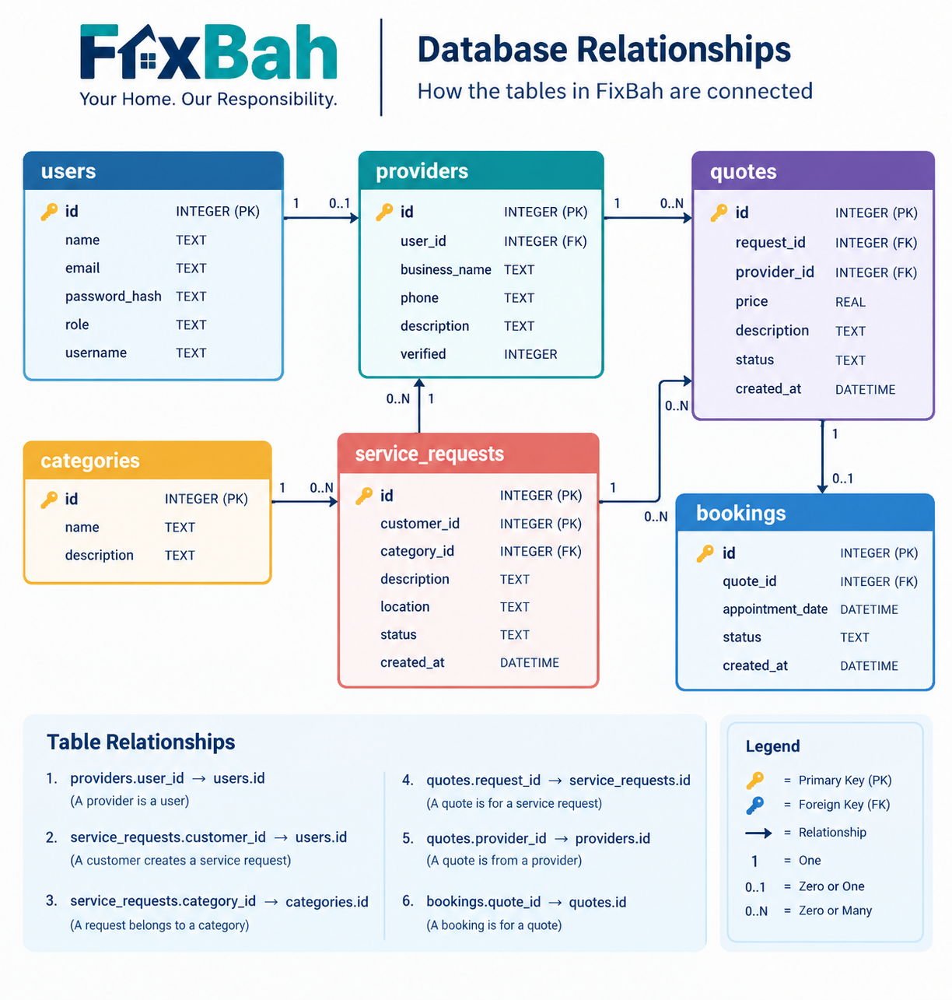

# FixBah — Home Services Booking Platform

## CS50x Final Project

**Author:** Ali Shakeeb  
**Course:** CS50x — Introduction to Computer Science 
**Year:** 2026
#### Video Demo:  https://youtu.be/kwCf5iHMP68

## About the Project

**FixBah** is a web-based platform designed to connect customers with
home service providers in Bahrain.

The project was developed to address a real need among customers in
Bahrain. There is a need for a professional, dedicated platform that
makes it easier for customers to find home service providers, compare
quotations, and book appointments.

FixBah aims to help fill this gap by providing a convenient platform
where customers and service providers can connect and manage their
service requests.

The next step is to publish FixBah on the internet, making the
platform accessible to customers and service providers throughout
Bahrain.

**Tagline:** Your Home. Our Responsibility.

## Features

### Customer Features

- Register for an account and log in.
- Access a personal dashboard.
- Submit home service requests.
- View submitted service requests.
- Receive and review provider quotations.
- Select a suitable quotation.
- Book appointments with service providers.
- View service request and booking information.

### Service Provider Features

- Register for an account and log in.
- Access a provider dashboard.
- View and manage customer service requests.
- Submit quotations to customers.
- Manage appointments.
- Maintain provider profile information.

### Website Features

- Separate dashboards for customers and service providers.
- Database storage for application information.
- Responsive interface using Bootstrap.
- Custom website styling.
- Validation to prevent processed quotations from being booked again.

## How It Works

FixBah connects customers with home service providers through a
quotation and appointment booking process.

### For Customers

1. Register for an account and log in.
2. Access the customer dashboard.
3. Submit a request describing the required home service.
4. Review quotations submitted by service providers.
5. Choose a suitable quotation.
6. Proceed to book an appointment.
7. View service requests and booking information.

### For Service Providers

1. Register for an account and log in.
2. Access the provider dashboard.
3. Review customer service requests.
4. Submit quotations for suitable requests.
5. View and manage appointments.
6. Maintain provider profile information.

### Booking Process

Customer submits a service request  
↓  
Provider reviews the request  
↓  
Provider submits a quotation  
↓  
Customer selects a quotation  
↓  
Customer books an appointment

## Database Relationships

FixBah uses an SQLite database to manage customers, service providers, service requests, quotes, and bookings.

The following diagram illustrates the database tables and their relationships.



### Main Relationships

- **Users and Providers:** A provider account is linked to a user account.
- **Users and Service Requests:** Customers can create service requests.
- **Categories and Service Requests:** Each service request belongs to a category.
- **Service Requests and Quotes:** Providers can submit quotes for service requests.
- **Providers and Quotes:** Each quote is submitted by a provider.
- **Quotes and Bookings:** A booking is associated with a quote.

## Technologies Used

- **Python** — Application logic.
- **Flask** — Web framework.
- **SQLite** — Database management.
- **HTML5** — Webpage structure.
- **CSS3** — Website styling.
- **Bootstrap** — Responsive layouts and interface components.
- **Jinja** — Dynamic HTML templates.

## Project Structure

Final_Project/
│
├── app.py
├── database.py
├── users.db
├── requirements.txt
├── README.md
│
├── templates/
│   ├── index.html
│   ├── login.html
│   ├── register.html
│   ├── dashboard.html
│   ├── provider_dashboard.html
│   ├── request_service.html
│   ├── my_requests.html
│   ├── my_quotes.html
│   ├── book_appointment.html
│   ├── provider_profile.html
│   ├── provider_requests.html
│   └── provider_appointments.html
│
├── static/
│   ├── css/
│   │   └── style.css
│   │
│   └── images/
│       ├── ac.jpeg
│       ├── electrical.jpeg
│       └── plumbing.jpeg
└── venv/

The `venv/` directory is used for the local Python virtual environment
and should not normally be included in the GitHub repository.

## Installation and Setup

### Requirements

- Python 3
- pip
- A web browser

### 1. Open the Project Directory

Open Terminal and navigate to the project folder:

```bash
cd ~/Documents/CS50/Final_Project
```

### 2. Create a Virtual Environment

Create an isolated Python environment:

```bash
python3 -m venv venv
```

If the virtual environment already exists, you do not need to
create it again.

### 3. Activate the Virtual Environment

On Ubuntu or Linux:

```bash
source venv/bin/activate
```

### 4. Install the Dependencies

Install the required Python packages:

```bash
python -m pip install -r requirements.txt
```

### 5. Run the Application

Start the Flask application:

```bash
python app.py
```

### 6. Open FixBah

Open your web browser and visit:

http://127.0.0.1:5000

### 7. Stop the Application

Return to the terminal and press:

`Ctrl + C`

To leave the virtual environment, run:

```bash
deactivate
```
## Project Goal

The goal of FixBah is to make home services easier to find and book
by connecting customers and service providers through one platform.

This project demonstrates how Python, Flask, SQLite, HTML, CSS,
and Bootstrap can be used to develop a database-driven web application.

## Future Improvements

Possible future improvements include:

- Online payment integration.
- Customer reviews and ratings.
- Email and SMS notifications.
- Additional home service categories.
- Improved appointment notifications.
- Publishing the platform online for customers and providers
  throughout Bahrain.

## Author

**Ali Shakeeb**

Developed as the CS50x Final Project in 2026.

## License

This project was developed for educational purposes.